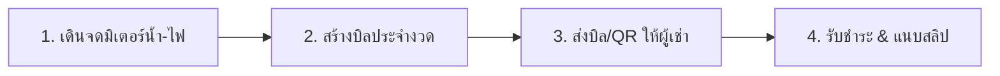

# 🏢 ระบบจัดการหอพักและค่าน้ำค่าไฟ (Dormitory Management System)
### พัฒนาด้วย HTML5 + Bootstrap 5 + SweetAlert2 + Google Sheets Database (Google Apps Script API)

ระบบบริหารจัดการหอพัก ห้องพัก ผู้เช่า บันทึกมิเตอร์น้ำ-ไฟ ออกใบแจ้งหนี้/ใบเสร็จรับเงิน พร้อม QR Code พร้อมเพย์ (BOT EMVCo มาตรฐานธนาคาร) สแกนจ่ายได้จริง พร้อมระบบแนบรูปสลิป สามารถทำงานได้ทั้งบนเบราว์เซอร์ผ่าน XAMPP หรือเปิดไฟล์ `index.html` ได้โดยตรง และออนไลน์ผ่าน Google Apps Script ฟรี 100% โดยไม่ต้องเช่าเซิร์ฟเวอร์

---

## 🔑 1. ข้อมูลการเข้าสู่ระบบ (Login)
- **URL เข้าใช้งาน (XAMPP):** `http://localhost/0002/index.html` หรือเปิดไฟล์ [index.html](file:///c:/xampp/htdocs/0002/index.html) ในเว็บเบราว์เซอร์
- **สิทธิ์การใช้งาน:** ผู้ดูแลระบบ (Admin)
- **ชื่อผู้ใช้ (Username):** `admin`
- **รหัสผ่าน (Password):** `admin123` (หรือ PIN `1234`)

---

## 🚀 2. การเชื่อมต่อกับฐานข้อมูล Google Sheets (ใช้เวลา 3 นาที)

ระบบนี้รองรับ **Dual Mode**:
1. **โหมดเริ่มต้น (Offline / Local Demo):** เมื่อเปิดขึ้นมาครั้งแรก ระบบจะมีฐานข้อมูลจำลอง (Mock Data) ให้ทดลองใช้งาน ฟังก์ชันทุกอย่างทำงานได้ครบถ้วนทันที
2. **โหมดออนไลน์ (Google Sheets Database):** เชื่อมต่อไปยัง Google Sheet ของคุณเพื่อเก็บข้อมูลจริงถาวร

### ขั้นตอนการเชื่อมต่อ Google Sheets:
1. เปิดเว็บเบราว์เซอร์ไปที่ **[https://sheets.new](https://sheets.new)** เพื่อสร้าง Google Sheet ใหม่ และตั้งชื่อไฟล์ว่า `ระบบจัดการหอพัก`
2. ที่แถบเมนูด้านบนของ Google Sheets คลิกที่ **ส่วนขยาย (Extensions)** ➡️ **Apps Script**
3. คัดลอกโค้ดทั้งหมดในไฟล์ [Code.gs](file:///c:/xampp/htdocs/0002/Code.gs) ไปวางแทนที่โค้ดเดิมในโปรแกรมแก้ไขสคริปต์ แล้วกด **บันทึก (Ctrl + S)**
4. รันสร้างตารางอัตโนมัติ:
   - ที่แถบเครื่องมือด้านบน เลือกฟังก์ชัน **`initDatabase`** แล้วกดปุ่ม **เรียกใช้ (Run)**
   - กดยืนยันให้สิทธิ์เข้าถึง (Review Permissions ➡️ ขั้นสูง/Advanced ➡️ ไปยังโครงการ/Go to unsafe ➡️ อนุญาต/Allow)
   - กลับไปดูที่ Google Sheet จะพบว่าสร้างชีต 7 ตารางพร้อมหัวคอลัมน์สีเข้มและข้อมูลตัวอย่างให้เรียบร้อยแล้วทันที!
5. เผยแพร่เป็น Web App:
   - ที่มุมขวาบน กดปุ่มสีน้ำเงิน **การทำให้ใช้งานได้ (Deploy)** ➡️ **การทำให้ใช้งานได้รายการใหม่ (New deployment)**
   - คลิกรูปฟันเฟือง ⚙️ ข้าง "เลือกประเภท" แล้วเลือก **เว็บแอป (Web app)**
   - ดำเนินการในฐานะ (Execute as): **ฉัน (Me)**
   - ผู้ที่มีสิทธิ์เข้าถึง (Who has access): **ทุกคน (Anyone)** *(สำคัญมาก เพื่อให้เว็บแอปเรียก API ได้)*
   - กดปุ่ม **ทำให้ใช้งานได้ (Deploy)**
6. คัดลอก **URL ของเว็บแอป (Web app URL)** (ที่ลงท้ายด้วย `/exec`) นำมาวางที่:
   - เมนู **"ตั้งค่าระบบ" (Settings)** ➡️ ในช่อง **"Google Apps Script Web App URL"** แล้วกดปุ่ม **"ทดสอบเชื่อมต่อ"** หรือกดที่ปุ่มสถานะสีเหลืองมุมขวาบน
   - เมื่อเชื่อมต่อสำเร็จ แถบสถานะมุมขวาบนจะเปลี่ยนเป็น **🟢 Google Sheets เชื่อมต่อแล้ว** ทันที!

---

## 🔄 3. วงจรการทำงานประจำเดือน (Monthly Routine Workflow)

### ขั้นตอนที่ 1: เดินจดมิเตอร์น้ำ-ไฟ
1. ไปที่แท็บ **"จดมิเตอร์"**
2. เลือกรอบเดือนที่ต้องการจด (เช่น 2026-11)
3. ระบบจะดึงเลขมิเตอร์ครั้งก่อนหน้ามาแสดงให้อัตโนมัติ
4. กรอก **"เลขอ่านครั้งนี้"** ของน้ำประปาและไฟฟ้า
5. ระบบจะคำนวณจำนวนหน่วยใช้ให้อัตโนมัติสดๆ บนหน้าจอ
6. มีระบบแจ้งเตือน **กรอบสีแดง** ทันทีหากกรอกเลขอ่านครั้งนี้น้อยกว่าครั้งก่อน
7. กดปุ่ม **"บันทึกมิเตอร์ทั้งหมด"**

### ขั้นตอนที่ 2: สร้างบิลประจำงวด
1. ไปที่แท็บ **"บิล & ใบเสร็จ"** หรือกดปุ่มลัด **"สร้างบิลประจำงวด"**
2. เลือกรอบเดือนที่ต้องการออกบิล และกำหนดวันครบกำหนดชำระ (Due Date)
3. ระบบจะคำนวณยอดเงินรวมให้อัตโนมัติ:  
   $$\text{ยอดรวม} = \text{ค่าเช่าห้อง} + (\text{หน่วยน้ำ} \times \text{ค่าน้ำ}) + (\text{หน่วยไฟ} \times \text{ค่าไฟ}) + \text{ค่าส่วนกลาง}$$
4. กดยืนยันสร้างบิล ระบบจะสร้างบิลให้เฉพาะสัญญาที่ยังไม่ได้ออกบิลในเดือนนั้น ป้องกันการออกบิลซ้ำซ้อน

### ขั้นตอนที่ 3: ส่งบิลให้ผู้เช่า
1. ในหน้า **"บิล & ใบเสร็จ"** กดปุ่ม **"พิมพ์"** ที่บิลของห้องที่ต้องการ
2. หน้าต่างเอกสารจะเปิดขึ้นมาในรูปแบบ **"ใบแจ้งหนี้ / ใบเรียกเก็บเงิน (Invoice)"**
3. มีแจกแจงรายการค่าห้อง ค่าน้ำ ค่าไฟ และหน่วยที่ใช้อย่างชัดเจน
4. มี **QR Code พร้อมเพย์** มาตรฐาน BOT EMVCo ยอดเงินตรงตามยอดบิล สามารถเปิดแอปธนาคารสแกนจ่ายได้ทันที
5. ผู้ดูแลสามารถกดปุ่ม **"สั่งพิมพ์ / Save as PDF"** เพื่อบันทึกเป็นไฟล์ PDF ส่งให้ผู้เช่าทาง LINE ได้สะดวก

### ขั้นตอนที่ 4: บันทึกรับชำระเงินและแนบสลิป
1. เมื่อผู้เช่าโอนเงินและส่งสลิปหลักฐานมา ให้กดปุ่ม **"รับเงิน"** ที่รายการบิลนั้น (หรือปุ่ม "รับเงินด่วน" บนหน้าแดชบอร์ด)
2. เลือกช่องทาง: **โอนเงินผ่านธนาคาร/พร้อมเพย์** หรือ **เงินสด**
3. ระบุวัน-เวลาที่ได้รับเงิน
4. แนบไฟล์รูปสลิปหลักฐาน (ระบบจะแสดงรูปตัวอย่างทันที และบันทึกลงใน Google Drive หรือ Local)
5. กดยืนยันบันทึก:
   - บิลจะเปลี่ยนสถานะเป็น **"ชำระแล้ว (Paid)"** สีเขียวทันที
   - ยอดค้างชำระบนหน้าแดชบอร์ดจะลดลง และยอดรายรับจะเพิ่มขึ้นทันที
   - เมื่อเปิดดูเอกสารบิลอีกครั้ง เอกสารจะเปลี่ยนหัวเป็น **"ใบเสร็จรับเงิน (Receipt)"** พร้อมตราประทับสีเขียว **"ชำระแล้ว (PAID)"**

---

## 📋 4. คุณสมบัติเด่นของระบบ
- **3 มุมมองห้องพัก (Room Views):** มุมมองการ์ด (Grid), มุมมองแยกตามชั้น (By Floor), และมุมมองตาราง (Table) พร้อมตัวกรองค้นหาแบบเรียลไทม์
- **นำเข้า/ส่งออก CSV รองรับภาษาไทย 100%:** ใส่รหัส `UTF-8 BOM` ไว้ในไฟล์ ทำให้เปิดไฟล์ `.csv` ด้วย Microsoft Excel แล้วภาษาไทยไม่เป็นภาษาต่างดาว
- **ระบบสัญญาและการ Check-out:** เมื่อทำสัญญาเช่าใหม่ ห้องจะเปลี่ยนเป็น "มีผู้เช่า" อัตโนมัติ และเมื่อกด "Check-out คืนห้อง" สัญญาจะย้ายไปเก็บที่ประวัติ และห้องจะกลับมาเป็น "ห้องว่าง" พร้อมรับผู้เช่าใหม่ทันที
- **PromptPay QR Code Generator:** ใช้อัลกอริทึมคำนวณ Checksum CRC16-CCITT ตามมาตรฐานของธนาคารแห่งประเทศไทย สแกนจ่ายได้จริงทุกธนาคาร
- **Responsive & Mobile Ready:** หน้าจอปรับแต่งให้พอดีกับทั้งสมาร์ตโฟน แท็บเล็ต และคอมพิวเตอร์ รองรับการเปิดใช้งานแบบเต็มจอ
